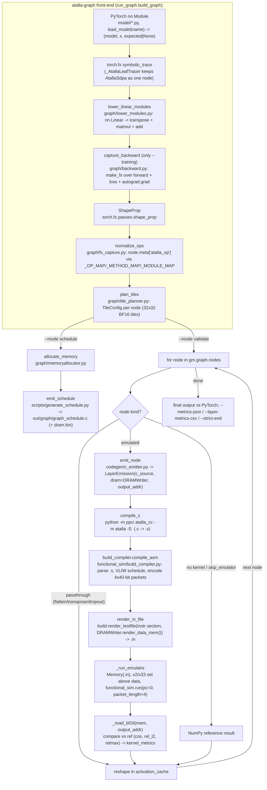
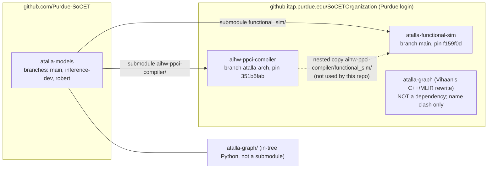

# atalla-models: visual repository guide

Where things live, how a model becomes an emulator run, and where to look when something breaks.
Verified against the `robert` branch on 2026-11-04 (compiler `351b5fab`, functional_sim `f159f0d`).
Companion docs: `ENVIRONMENT.md` (setup), `flat_ram_layout_finding.md` (RTL hand-off), `benchmark_metrics.md`
and `baselines/` (harness output), `../pipeline_reference.md` (deep dive).

## 1. Pipeline flow

Notes that matter when reading the diagram:

* **Validate mode runs one emulator per node.** State is fresh for each `.in`; only `activation_cache`
  (BF16 NumPy arrays keyed by node name) links layers. `--validate-inputs oracle` reloads PyTorch
  activations before every emulated op; `chained` (default) feeds the previous emulator output.
* **Packetization lives in two places.** The compiler has its own packetizer (`aihw-ppci-compiler/
  ppci/arch/atalla/packetizer.py`, enabled with `atalla_cc -p`); `tests/kernels` uses it with
  `build_compiler.py --prepacked`. The graph path (`c_emitter.compile_and_assemble`) still uses the legacy
  `build_compiler.compile_asm` scheduler. Both produce the same `.in` format.
* **`--training`** builds the forward + MSE loss + backward graph and validates predictions, loss, and
  every parameter gradient on the emulator (`run_validate(training=True)`); `run_schedule` still rejects
  combined graphs.

## 2. Repository / submodule layout

| Path | What | Host / pin |
|---|---|---|
| `atalla-models` (this repo) | graph front-end, emitters, docs, tests, benchmark harness | github.com `Purdue-SoCET/atalla-models` |
| `aihw-ppci-compiler/` | ppci fork: AtallaC front-end, Atalla backend, packetizer, `atalla_cc` | ITaP, branch `atalla-arch`, `351b5fab` |
| `functional_sim/` | emulator (`src/`), assembler/scheduler (`build.py`, `build_compiler.py`), `.in` -> hex converter | ITaP, branch `main`, `f159f0d` |
| `atalla-graph/` | in-tree; the SoCET Python graph pipeline (see section 3) | part of this repo |

Branch model: `main` is the shared integration branch; `inference-dev` carries the inference-only pipeline
work; `robert` is this semester's working branch (worktree `atalla-models-rz`) based on `inference-dev` +
`main`. History note: `main`'s older sim pin `ef513d0b` no longer resolves (dangling after the ITaP move), so
check out `robert`/`inference-dev` pins rather than `main`'s.

## 3. Directory map of `atalla-graph/`

| File | One line | Key names |
|---|---|---|
| `run_graph.py` | CLI and orchestration: build graph, validate per node on the emulator, or emit a schedule | `build_graph`, `run_validate`, `run_schedule`, `load_model`, `_run_emulator`, `_read_bf16`, `_layer_compare_metrics`, `_compare_gradients`, `_aggregate_kernel_metrics`, `main` |
| `main.py` | Vihaan's original entry point (export FX graph + schedule); superseded by `run_graph.py` | - |
| `graph/fx_capture.py` | FX trace helpers and op normalisation; maps torch functions/methods/modules to `atalla_op` strings | `_OP_MAP`, `_METHOD_MAP`, `_MODULE_MAP`, `normalize_ops`, `capture`, `get_node_shape` |
| `graph/lower_modules.py` | Rewrites `nn.Linear` call_module nodes into `transpose + matmul + add` with explicit `get_attr` weights | `lower_linear_modules`, `_ensure_attr_node` |
| `graph/backward.py` | Captures forward + loss + `torch.autograd.grad` under `make_fx`; tags `phase`, `parameter_name`, `gradient_names` | `capture_backward` |
| `graph/tile_planner.py` | Per-op tile planning (M/N/K tiles, SDMA geometry); marks ops without a planner `pending=True` | `TileConfig`, `_plan_conv`, `_plan_linear`, `_plan_matmul`, `_plan_sdpa`, `_plan_layernorm`, `_plan_threshold_backward`, `_plan_mse_loss*`, `plan_tiles` |
| `graph/memoryallocator.py` | Static DRAM allocation for schedule mode (2 KB-aligned BF16 tiles, `dram.bin` payload) | `allocate_memory`, `fake_allocate_memory`, `assign_address`, `tensor_nbytes` |
| `graph/export_fx.py` | Renders the FX graph with metadata to an image via `FxGraphDrawer` (needs `pydot`) | `attach_metadata`, `render_graph` |
| `graph/layer_metrics_csv.py` | Per-layer CSV + template rollup from `kernel_metrics` (byte split, flops/packet, packet share) | `write_layer_metrics_csv`, `write_template_summary_csv`, `enrich_derived_csv_fields` |
| `codegen/c_emitter.py` | One `emit_<op>` per supported op: builds AtallaC source + `DRAMWriter` image (config at `ADDR_TABLE=0x3C`, tensors from `0x1000`); compiles and assembles | `LayerEmission`, `emit_node`, `emit_conv/linear/matmul/relu/softmax/maxpool/add/mul/sdpa/layernorm/gelu/threshold_backward/sum_dim/mse_loss(_backward)`, `compile_c`, `compile_and_assemble`, `render_in_file` |
| `codegen/dram_builder.py` | BF16 helpers and extraction of weights / reference activations from the graph | `extract_weights`, `extract_input_data`, `tensor_to_bf16_bytes` |
| `kernels/common.py` | Shared constants: `ADDR_TABLE = 60`, `TILE = 32`, SDMA control-word packing | `sdma_ctl_val`, `sdma_ctl_expr` |
| `kernels/gemm.py` | Tiled GEMM generator used by conv/linear/matmul (`load_weight_tile` -> `load_weights` x32 -> `gemm` rows). **Weight-load order**: upstream `investigate-weight-load-order` will flip `lw.vi` to last-to-first; the weight loop here must be reversed when that lands | `gemm_c` |
| `kernels/relu.py`, `add.py`, `mul.py`, `softmax.py`, `maxpool.py`, `layernorm.py`, `gelu.py`, `avgpool.py`, `batchnorm.py`, `upsample.py`, `sum_dim.py`, `mse_loss.py`, `mse_loss_backward.py`, `threshold_backward.py` | Parameterised AtallaC generators (`<op>_c(...) -> str`), config read as `*(cfg_ptr + n)`, end with `atalla_halt()` | `<op>_c` |
| `kernels/*.c`, `kernels.h`, `kernels.c`, `flash_sdpa_n32d32.c` | Static reference kernels: standalone `.c` goldens for `tests/kernels`, legacy prototypes, fused flash attention for ViT Micro | - |
| `model/basic.py` | `BasicModule(dim, depth)`: linear + relu + residual mul/add; the smoke model | `BasicModule` |
| `model/alexnet_small.py` | Scaled-down AlexNet (`scale` shrinks channels); 21 emulated nodes at `scale=0.01` | `AlexNetSmall` |
| `model/alexnet.py` | torchvision AlexNet wrapper (224x224) | - |
| `model/layernorm_smoke.py` | LayerNorm-only smoke model | `LayerNormSmoke` |
| `model/vit_micro.py`, `model/atalla_ops.py` | Tiny ViT (dim=32, 32 tokens) using `AtallaSdpa`, a fused attention leaf | `ViTMicro`, `AtallaSdpa` |
| `model/efficientformerv2.py` | EfficientFormerV2 reference (not wired into `load_model`) | - |
| `scripts/generate_schedule.py` | Vihaan's schedule emitter: FX graph -> sequential C kernel calls | `emit`, `_render_kernel_calls` |
| `scripts/run_operator_regressions.py` | One-shot regression gate over the matmul/maxpool/conv golden harnesses | `main` |
| `scripts/debug_{matmul,conv,maxpool}_golden.py` | Standalone per-op goldens with BF16 reference and emulator run | `main` |
| `scripts/capture_regression_baselines.py` | Writes validate metrics JSONs under `out/regression_baselines/` | `main` |
| `scripts/export_alexnet_kernel_bundle.py` | Copies first `.c/.s/.in` per op into a bundle for hand-off | `main` |
| `scripts/pipelining_latency_model.py` | Analytic DMA-vs-compute pipelining estimate from perf files (not cycle accurate) | `evaluate_pipelining` |
| `plot_graph_layer_packet_share.py` | Plot per-layer packet share from a metrics JSON | - |
| `docs/` | `compiler_review_handoff.md`, `correctness_timeline.md`, `vit_micro/` write-up + figures | - |
| `tests/test_backward_graph.py` | CPU-only graph-capture tests (forward parity, gradients, boundaries) | `BackwardGraphTests` |
| `out/` | run outputs (gitignored) | - |

Repo-level: `tests/kernels/` (standalone kernel suite: compile with `atalla_cc -p -S`, spill check,
`build_compiler --prepacked`, simulate, golden diff; `_paths.py` resolves the toolchain),
`run_kernel_tests.sh`, `bench/run_benchmark.py` + `bench/build_workbook.py` (benchmark harness ->
`docs/baselines/`, `output/Atalla_Benchmarking_Workbook.xlsx`), `docs/`.

## 4. Where to look when X breaks

| Symptom | First place to look |
|---|---|
| `ValueError: Unknown model` | `run_graph.load_model`; model must return `(model, x, expected_or_None)` |
| `Unknown mnemonic for scheduling` / encode error | `functional_sim/build_compiler.py` aliases vs `functional_sim/ASSEMBLY_SYNTAX.md`; opcode tables in `functional_sim/src/misc/opcode_table.py` and `aihw-ppci-compiler/ppci/arch/atalla/instructions.py` must agree |
| `No module named ppci` from `atalla_cc` | `atalla_cc` is `#!/usr/bin/env python3`; run it as `$VENV/bin/python aihw-ppci-compiler/atalla_cc ...` (tests do this) or activate the venv |
| `Tree ... not covered` / stack-frame overflow from ppci | too many live `vec` values in the generated C; see `kernels/<op>.py` and `pipeline_reference.md` 3.3 |
| cos ~ 0 or NaN on one layer | DRAM layout (`codegen/c_emitter.py emit_<op>`: `ADDR_TABLE` words, tensor bases), SDMA control word (`kernels/common.py`), BF16 packing (`_read_bf16`); run with `--validate-inputs oracle` to isolate the layer |
| Final cos fine but a matmul layer bad | expected under `oracle`; use `chained` for the real end-to-end signal (`run_validate` docstring) |
| GEMM wrong after a compiler/sim bump | weight-load order (`kernels/gemm.py` loop vs `lw.vi` semantics in `functional_sim/src/functional_sim.py` gemm weight handling); `scripts/debug_matmul_golden.py` |
| Op silently runs on NumPy | `emission.skip_emulator`, missing `emit_<op>` dispatch in `emit_node`, or missing `atalla_op` mapping in `fx_capture.py` |
| `pending_kernel_ops` lists an op | no tile planner in `tile_planner.plan_tiles` for that ATen op (backward graphs) |
| Submodule checkout fails / wrong pins | `.gitmodules` points at ITaP; see `ENVIRONMENT.md`; never `git submodule update --remote` |
| Flat hex for RTL does not run | `docs/flat_ram_layout_finding.md` (code/data overlap at `0x3C`) |
| Metrics missing fields | `run_graph._aggregate_kernel_metrics` and `graph/layer_metrics_csv.py`; the harness schema is in `docs/benchmark_metrics.md` |
